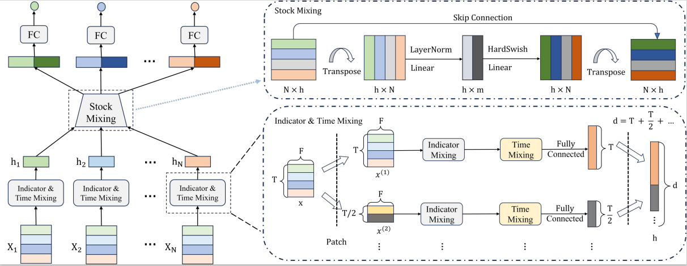

# StockMixer

Official code implementation and supplementary material of AAAI 2024 paper "**StockMixer: A Simple yet Strong MLP-based Architecture for Stock Price Forecasting**". This work proposes a lightweight and effective MLP-based architecture for stock price forecasting named StockMixer. It consists of indicator mixing, temporal mixing and stock mixing to capture complex correlations in the stock data. The end-to-end training flow of StockMixer is presented as follows:



## Original paper environment

- Python 3.7
- torch~=1.10.1
- numpy~=1.21.5
- PyYAML, pandas, tqdm, matplotlib

## Original US datasets

The original datasets(NASDAQ, NYSE and S&P500) are respectively available:

NASDAQ/NYSE: [Temporal Relational Ranking for Stock Prediction](https://github.com/fulifeng/Temporal_Relational_Stock_Ranking)

S&P500: [Efficient Integration of Multi-Order Dynamics and Internal Dynamics in Stock Movement Prediction](https://github.com/thanhtrunghuynh93/estimate)

In order to improve file reading speed, we process the raw data to generate corresponding .pkl or .npy files. Datasets are provided in the `dataset` folder. Because StockMixer does not require prior knowledge similar to graphs or hypergraphs, our preprocessed dataset did not provide either. You can find them from the original datasets.

## 台股市值前 50 家

台股流程使用 Python 3.10 以上。在專案根目錄執行：

```bash
python -m pip install -r requirements.txt
python src/download_tw50.py --start 2018-01-01
python src/train.py --epochs 1
```

下載程式以臺灣證券交易所最新行情快照的收盤價乘以上市公司已發行普通股數估算市值，依此選出 50 家台灣上市公司（涵蓋所有產業）。使用 Yahoo Finance 下載還原日線 OHLC 及成交量，並以加權指數交易日對齊。預設排除今天以避免盤中行情。可用 `--end YYYY-MM-DD` 指定不含該日的下載結束日期。歷史區間參數只影響行情，不會更改選股時點。

下載會產生 `dataset/TW50/tw50.npz`（股票 × 交易日 × OHLCV）與 `tw50.companies.csv`（代碼、市值、產業別、行情快照日期及排序）。缺漏行情保留為 NaN，訓練時會屏蔽缺資料的預測目標。訓練以 16 個交易日預測下一交易日的報酬率，依目標日期順序分為 70% 訓練、15% 驗證、15% 測試。

這是以最新排名回溯歷史行情的固定股票池。歷史回測會有成分股選擇偏誤，若要評估當時可執行的策略，需要歷史各期的股票池。
